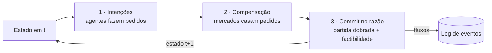

# abm-exploration

Exploração de modelos macroeconômicos baseados em agentes (ABMs) construídos de forma composicional, com agentes que aprendem, consistência stock-flow por construção e uma pergunta de fundo: **quando um modelo heterogêneo (ABM) se reduz a um modelo padrão (agente representativo, HANK), e o que se perde quando não se reduz?**

O projeto é também um pretexto para estudar economia e um exercício de **diálogo entre teorias**: pensar com axiomas novos (heterodoxia: rotinas, aprendizado, fora do equilíbrio) e provar com critérios compartilhados (ortodoxia: identificação, validação, previsão).

## Mapa do repositório

| Caminho | O que é |
| --- | --- |
| [`docs/01-programa-de-pesquisa.md`](docs/01-programa-de-pesquisa.md) | Programa de pesquisa de longo prazo: tese, três pilares, seis fases, artigos possíveis, riscos, referências conferidas |
| [`docs/02-caderno-de-exploracao.md`](docs/02-caderno-de-exploracao.md) | Notas abertas: teoria das categorias, micro → macro, autorreferência, heurísticas, termodinâmica, calibração vs Adam, HANK como limite de ABMs, E-estabilidade, "quantos agentes são muitos" |
| [`docs/03-projeto-pessoal.md`](docs/03-projeto-pessoal.md) | O recorte pessoal: progressão SIM → PC → heterogêneo → AB-SFC, arquitetura do tick, esboço em AlgebraicJulia, razão de partida dobrada, event sourcing, mercados plugáveis |
| [`experiments/`](experiments/README.md) | Um documento por toy experiment, com pergunta, protocolo e critério de sucesso |
| [`CLAUDE.md`](CLAUDE.md) | Contexto para continuar o trabalho com o Claude Code |

## Arquitetura em uma figura

## Stack pretendida

- **Julia**: simulação; **AlgebraicJulia** (Catlab.jl, AlgebraicDynamics.jl, StockFlow.jl) para a composição.
- **Arrow/Parquet + DuckDB**: log de eventos e projeções (balanço, matriz de fluxos).
- XTDB ou Datomic como opção futura de registro imutável.

## Status

Fase de desenho. Nenhum código ainda; o primeiro passo é o [experimento 01](experiments/01-sim-composicional.md) (SIM em Julia puro e depois composicional). Os experimentos [05](experiments/05-campo-medio-escala-n.md) e [06](experiments/06-e-estabilidade-cobweb.md) são independentes e podem começar em paralelo.

## Origem

Consolidado a partir de conversas com o Claude em 5 e 12 de novembro de 2026. As referências marcadas como "de memória" ainda precisam ser conferidas.
