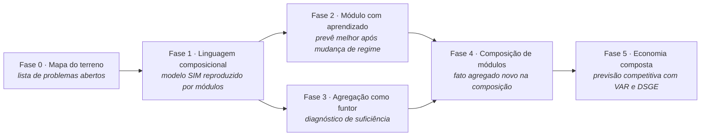

# Programa de pesquisa: ABMs composicionais com agentes que aprendem

5 nov. 2026 · Felipe Paradas

> Plano formal de longo prazo. As ideias soltas ficam em [02-caderno-de-exploracao.md](02-caderno-de-exploracao.md) e o recorte pessoal em [03-projeto-pessoal.md](03-projeto-pessoal.md).

## Visão geral

**Tese:** modelos macroeconômicos baseados em agentes ficam mais confiáveis quando três coisas andam juntas: agentes que aprendem, calibração disciplinada por microdados e uma linguagem composicional que garante que os módulos se encaixam de forma consistente.

Cada pilar ataca uma fraqueza conhecida dos ABMs. Aprendizado responde à crítica de Lucas, microdados respondem ao excesso de graus de liberdade e a linguagem composicional responde à falta de modularidade, comparabilidade e reprodutibilidade. Hoje essas peças existem em comunidades separadas (macro computacional, econometria e teoria das categorias aplicada) que quase não conversam.

**Pergunta central:** é possível construir uma economia simulada a partir de módulos calibrados separadamente, com agentes que aprendem, cuja composição preserve consistência contábil e cujas agregações possam ser comparadas formalmente com modelos reduzidos (agente representativo, HANK)?

## Motivação

O programa existe porque cada abordagem atual resolve um problema e deixa outro aberto.

| Abordagem | O que resolve | O que deixa aberto |
| --- | --- | --- |
| DSGE com agente representativo | Disciplina de otimização, intuição analítica | Agregação sem justificativa geral (Sonnenschein-Mantel-Debreu), crises endógenas mal representadas |
| HANK | Heterogeneidade com otimização | Custo computacional alto, pouca interação direta entre agentes, redes ausentes |
| ABMs tradicionais | Redes, não linearidades, crises endógenas | Regras comportamentais ad hoc (crítica de Lucas), excesso de parâmetros, baixa reprodutibilidade |
| Teoria das categorias aplicada | Composição formal, comparação entre modelos | Quase nenhum contato com dados econômicos ou com macro aplicada |

Três problemas atravessam todas as linhas:

- **Feedback semântico.** Agentes formam crenças sobre o sistema do qual fazem parte. Regras fixas, determinísticas ou estocásticas, quebram quando a política muda.
- **Graus de liberdade.** ABMs ajustam quase qualquer fato estilizado, o que enfraquece a validação.
- **Não composição.** Cada modelo é construído do zero. Módulos de papers diferentes não se juntam com garantia de consistência.

## Os três pilares

### 1. Agentes que aprendem

A hipótese invariante deixa de ser *o que o agente faz* e passa a ser *como o agente aprende*. Quando a política muda, o comportamento muda endogenamente pela regra de aprendizado.

- **Aprendizado adaptativo:** agentes estimam relações por mínimos quadrados recursivos (Evans e Honkapohja).
- **Troca de heurísticas:** agentes escolhem entre regras simples conforme desempenho recente (Brock e Hommes).
- **Aprendizado por reforço:** otimização por tentativa e erro, sem modelo explícito.
- **Agentes com LLM:** fronteira experimental, útil para gerar hipóteses comportamentais, fraca em validação.

### 2. Disciplina por microdados

O comportamento individual é calibrado diretamente em dados administrativos, não apenas por momentos agregados. Isso reduz graus de liberdade e permite validação fora da amostra e entre regimes de política.

- **Dados brasileiros candidatos:** RAIS e CAGED (emprego), SCR (crédito), PIX (pagamentos), dados imobiliários de cartórios e ITBI municipal. O acesso a alguns exige convênio ou sala segura.
- **Métodos:** método dos momentos simulados, inferência bayesiana baseada em simulação, estimação neural da posterior e emuladores que imitam o ABM para tornar a estimação viável.

### 3. Linguagem composicional

Agentes e módulos são tratados como sistemas abertos com interfaces tipadas. Em teoria das categorias, um agente que age e recebe feedback é uma *lens*: ação para frente, sinal de avaliação para trás. Open games e aprendizado por gradiente têm essa mesma estrutura, o que permite tratar agente que joga e agente que aprende como o mesmo objeto.

- **Composição:** wiring diagrams e cospans estruturados para colar módulos (famílias, firmas, bancos, governo).
- **Consistência por construção:** fluxos sem contrapartida não tipam, como em modelos stock-flow consistent.
- **Comparação:** agregação tratada como funtor. Se a agregação preserva estrutura, o modelo reduzido basta; se não, a falha mostra onde a heterogeneidade importa.

## Plano passo a passo

O programa avança em seis fases. Cada uma termina com um critério de passagem: só se avança quando o resultado anterior se sustenta. As fases 2 e 3 podem correr em paralelo.

A fase 5 é o objetivo final; cada fase anterior já rende artigos por conta própria.

### Fase 0 — Mapa do terreno

**Pergunta:** o que cada comunidade já resolveu e onde estão as lacunas entre elas?

- Revisão sistemática cruzando macro com ABMs, aprendizado em macro, inferência baseada em simulação e teoria das categorias aplicada.
- Glossário que traduz conceitos entre as áreas (lens ↔ agente com feedback, funtor ↔ agregação, cospan ↔ interface entre módulos).
- **Critério de passagem:** uma lista curta de problemas abertos que nenhuma das três comunidades resolve sozinha.

### Fase 1 — Linguagem composicional mínima

**Pergunta:** qual é o menor formalismo que representa agentes, módulos e fluxos contábeis com composição garantida?

- Definir agentes como sistemas abertos (lenses) e módulos como wiring diagrams com interfaces tipadas.
- Impor consistência stock-flow na própria estrutura da interface.
- Implementar uma biblioteca pequena, reaproveitando AlgebraicJulia onde fizer sentido.
- **Critério de passagem:** reproduzir exatamente um modelo stock-flow consistent clássico (por exemplo, o modelo SIM de Godley e Lavoie) montado a partir de módulos.

### Fase 2 — Um módulo com aprendizado e microdados

**Pergunta:** regras de aprendizado calibradas em microdados sobrevivem a uma mudança de regime de política?

- Escolher um mercado com dados ricos e mudança de política bem identificada: crédito (SCR, mudanças de regras macroprudenciais) ou imobiliário (ITBI, financiamento habitacional).
- Comparar famílias de aprendizado (adaptativo, troca de heurísticas, reforço) estimadas antes da mudança.
- Avaliar previsão depois da mudança, contra regras fixas.
- **Critério de passagem:** a regra de aprendizado prevê o comportamento pós-mudança melhor do que regras fixas calibradas no mesmo período.

### Fase 3 — Agregação como funtor

**Pergunta:** quando a agregação do ABM preserva estrutura, e o que acontece quando não preserva?

- Formalizar o mapa do ABM do módulo para uma versão agregada (agente representativo ou distribuição).
- Identificar condições em que esse mapa é um funtor, e medir o erro quando não é.
- Comparar com a versão HANK equivalente do mesmo mercado.
- **Critério de passagem:** um diagnóstico operacional que diz, para um módulo dado, se o modelo reduzido é suficiente.

### Fase 4 — Composição de módulos

**Pergunta:** dois módulos calibrados separadamente, ao serem compostos, geram dinâmica que nenhum gera sozinho?

- Compor crédito e imobiliário com agentes compartilhados (a mesma família toma crédito e compra imóvel).
- Resolver escalas de tempo diferentes e checar consistência contábil na interface.
- Recalibrar conjuntamente e medir quanto os parâmetros mudam em relação à calibração isolada.
- **Critério de passagem:** a composição reproduz pelo menos um fato agregado que os módulos isolados não reproduzem (por exemplo, o ciclo entre crédito e preço de imóveis).

### Fase 5 — Economia composta e política

**Pergunta:** o sistema composto é útil para avaliar política e para prever?

- Adicionar módulos de emprego (RAIS e CAGED) e de política monetária.
- Rodar experimentos de política macroprudencial e monetária com agentes que reagem aprendendo.
- Comparar previsões fora da amostra com VAR e DSGE, no estilo do trabalho de Poledna e coautores para a Áustria.
- **Critério de passagem:** previsão competitiva com os benchmarks e experimentos de política que não violam a crítica de Lucas por construção.

## Artigos ao longo do processo

O programa rende cerca de nove artigos, e a maioria fica de pé sozinha mesmo que as fases seguintes falhem. Os periódicos são sugestões de encaixe, não garantias.

| Fase | Artigo | Tipo | Onde encaixa |
| --- | --- | --- | --- |
| 0 | Survey: ABMs macro, aprendizado e composicionalidade, e as lacunas entre eles | Revisão | Journal of Economic Surveys |
| 1 | Uma linguagem composicional para modelos stock-flow consistent com agentes | Teórico e metodológico | Applied Category Theory (conferência) ou revista Compositionality |
| 1 | Biblioteca de software com o formalismo e o modelo SIM reproduzido | Software | Journal of Open Source Software |
| 2 | Aprendizado sobrevive à mudança de regime? Evidência com microdados de crédito no Brasil | Empírico | Journal of Economic Dynamics and Control |
| 2 | Inferência baseada em simulação para regras de aprendizado em ABMs | Metodológico | Computational Economics |
| 3 | Agregação como funtor: quando o agente representativo é legítimo | Teórico | Journal of Economic Behavior and Organization |
| 3 | ABM versus HANK no mesmo mercado: um diagnóstico de suficiência | Empírico e comparativo | Journal of Economic Interaction and Coordination |
| 4 | Composição de módulos calibrados: crédito e mercado imobiliário com agentes compartilhados | Aplicado | Journal of Economic Dynamics and Control |
| 5 | Política macroprudencial numa economia composta com agentes que aprendem | Aplicado e de política | Série de Trabalhos para Discussão do Banco Central do Brasil, depois periódico de campo |

Dois artigos são os mais ambiciosos e os de maior risco: o de agregação como funtor (fase 3) e o da economia composta (fase 5). Os de menor risco e saída mais rápida são o survey e o de software.

## Riscos e problemas abertos

O maior risco é técnico: a abstração categórica pode não escalar para milhões de agentes sem perder desempenho.

| Risco | Por que importa | Mitigação |
| --- | --- | --- |
| Formalismo não escala | Composição bonita no papel, lenta na prática | Separar especificação de execução: o formalismo gera código otimizado, não roda ele mesmo |
| Regras de aprendizado não identificadas | Várias regras explicam os mesmos dados | Usar mudanças de regime como variação identificadora e comparar famílias, não parâmetros isolados |
| Acesso a microdados | SCR e PIX exigem convênio ou sala segura | Começar com RAIS e CAGED públicos e buscar convênio em paralelo |
| Custo da calibração conjunta | Cada rodada do ABM composto é cara | Emuladores neurais e inferência baseada em simulação |
| Público dividido | Economistas não leem CT, e a comunidade de CT não lê macro | Escrever cada artigo para um público só, com o formalismo em apêndice quando o alvo é econômico |

**Critérios de sucesso do programa como um todo:**

- [ ] Um modelo clássico reproduzido a partir de módulos, com consistência garantida pela estrutura.
- [ ] Evidência de que agentes que aprendem preveem melhor do que regras fixas após mudança de regime.
- [ ] Um diagnóstico prático de quando a agregação é legítima.
- [ ] Uma economia composta com previsão competitiva com VAR e DSGE.

## Avaliação de viabilidade (conversa de 5 nov. 2026)

O programa completo é uma agenda de laboratório (3 a 5 pesquisadores, 6 a 10 anos), não um plano de execução individual. Recorte factível:

- **Fase 2 como pesquisa principal**: é, no fundo, uma pergunta de identificação com microdados e variação de política, território de microeconometria e inferência causal.
- **Fase 1 mínima como projeto pessoal paralelo**: reproduzir o SIM de forma composicional. Funciona como teste barato do pilar de CT.
- **Fases 3 a 5 como horizonte.**

Riscos sérios: o pilar de CT é o mais especulativo (pode virar formalismo elegante que não muda nenhuma conclusão econômica); a fase 3 pode ser mal posta se quase nenhuma agregação interessante for funtorial; a fase 5 é onde programas desse tipo morrem; SCR e PIX dependem do Banco Central.

Programas de doutorado considerados: CREST/IP Paris (microeconometria), IMPA (economia matemática; também probabilidade), MADE-USP (tradição SFC, Laura Carvalho), UFRJ e Unicamp (linha neoschumpeteriana/evolucionária).

## Referências

As referências com link foram conferidas online. Os clássicos sem link estão citados de memória e merecem conferência de edição antes de uso formal.

### Teoria das categorias aplicada

- Ghani, Hedges, Winschel e Zahn (2018), [Compositional game theory](https://arxiv.org/abs/1603.04641v2), LICS 2018. Introduz open games como fundação composicional da teoria dos jogos.
- Capucci, Gavranović, Hedges e Rischel (2022), [Towards foundations of categorical cybernetics](https://arxiv.org/abs/2105.06332v2), ACT 2021 / EPTCS 372. Unifica aprendizes e jogadores como sistemas com controlador.
- Cruttwell, Gavranović, Ghani, Wilson e Zanasi (2022), [Categorical foundations of gradient-based learning](https://discovery-pp.ucl.ac.uk/id/eprint/10160499), ESOP 2022. Aprendizado por gradiente como lenses parametrizadas.
- Baez, Li, Libkind, Osgood e Patterson, [Compositional modeling with stock and flow diagrams](https://arxiv.org/abs/2205.08373v3), ACT 2022. O pacote StockFlow.jl e a separação entre sintaxe e semântica.
- Libkind, Baas, Halter, Patterson e Fairbanks (2022), [An algebraic framework for structured epidemic modelling](https://classes.golem.ph.utexas.edu/category/2023/05/categories_for_epidemiology.html), Philosophical Transactions of the Royal Society A.
- Brown e Spivak (2023), [A graphical language for rewriting-based programs and agent-based models](https://act2023.github.io/papers/paper44.pdf), ACT 2023. ABMs como programas de reescrita de grafos no AlgebraicJulia.
- Lynch (2023), [Agent-based modeling via graph rewriting](https://topos.institute/blog/2023-07-07-agent-based-modeling-graph-rewriting/), Topos Institute. Introdução mais acessível ao mesmo tema.

### ABMs macroeconômicos

- Poledna, Miess, Hommes e Rabitsch (2023), [Economic forecasting with an agent-based model](https://dare.uva.nl/id/1f799e58-e821-4db5-99b1-199771059634), European Economic Review 151. Primeiro ABM competitivo com VAR e DSGE em previsão fora da amostra.
- Baptista, Farmer, Hinterschweiger, Low, Tang e Uluc (2016), [Macroprudential policy in an agent-based model of the UK housing market](https://www.bankofengland.co.uk/working-paper/2016/macroprudential-policy-in-an-agent-based-model-of-the-uk-housing-market), Bank of England Staff Working Paper 619.
- Carro, Hinterschweiger, Uluc e Farmer (2022), [Heterogeneous effects and spillovers of macroprudential policy in an agent-based model of the UK housing market](https://repositorio.bde.es/bitstream/123456789/21082/1/dt2217e.pdf), Banco de España DT 2217.
- Caiani, Godin, Caverzasi, Gallegati, Kinsella e Stiglitz (2016), [Agent based-stock flow consistent macroeconomics: towards a benchmark model](https://econpapers.repec.org/RePEc:eee:dyncon:v:69:y:2016:i:c:p:375-408), JEDC 69.

### Calibração e inferência

- Dyer, Cannon, Farmer e Schmon (2024), [Black-box Bayesian inference for agent-based models](https://www.inet.ox.ac.uk/publications/black-box-bayesian-inference-for-agent-based-models), JEDC 161. Estimação neural da posterior aplicada a ABMs econômicos. Código: github.com/joelnmdyer/sbi4abm.

### Agentes que aprendem

- Horton, Filippas e Manning, [Large language models as simulated economic agents: what can we learn from Homo silicus?](https://arxiv.org/abs/2301.07543v1), versão revisada em 2026.
- Evans e Honkapohja (2001), *Learning and Expectations in Macroeconomics*, Princeton University Press.
- Brock e Hommes (1997), "A rational route to randomness", Econometrica.

### Clássicos de contexto

- Lucas (1976), "Econometric policy evaluation: a critique".
- Sonnenschein (1972), Mantel (1974) e Debreu (1974), resultados sobre a demanda excedente agregada.
- Kaplan, Moll e Violante (2018), "Monetary policy according to HANK", American Economic Review.
- Godley e Lavoie (2007), *Monetary Economics: An Integrated Approach to Credit, Money, Income, Production and Wealth*.
- Rodrik (2015), *Economics Rules*.
