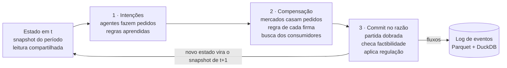
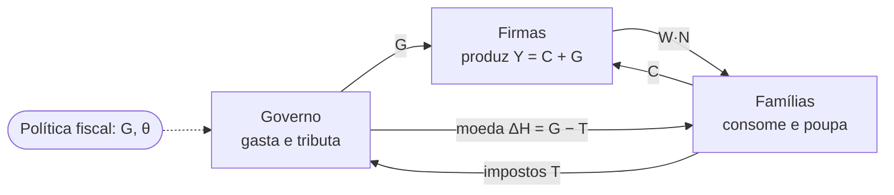

# Projeto pessoal: economia composicional como ponte entre teorias

5 nov. 2026 · Felipe Paradas

Um projeto pessoal para implementar modelos macro de forma composicional em AlgebraicJulia, usando a construção como pretexto para estudar economia e como ponte entre heterodoxia e ortodoxia. Complementa o [programa de pesquisa](01-programa-de-pesquisa.md) e o [caderno de exploração](02-caderno-de-exploracao.md). Os experimentos concretos estão em [`experiments/`](../experiments/README.md).

## A lente: diálogo entre teorias

**Princípio:** pensar com axiomas novos, provar com critérios compartilhados.

Cada lado tem um ponto cego que o outro enxerga:

| | Heterodoxia | Ortodoxia |
| --- | --- | --- |
| Força | Hipóteses mais realistas (rotinas, aprendizado, fora do equilíbrio) | Disciplina empírica (identificação, validação, previsão) |
| Fraqueza | Disciplina empírica mais frouxa | Hipóteses restritivas (otimização, agente representativo) |

O projeto tenta ficar no meio: construir com hipóteses heterodoxas e avaliar pelos padrões que o mainstream respeita. O exemplo de referência é o ABM de Poledna e coautores, que competiu com VAR e DSGE em previsão fora da amostra, ou seja, no critério do outro lado.

**O papel da teoria das categorias:** comparar teorias com axiomas diferentes é a vocação dela como meta-teoria. A contribuição-ponte mais concreta é mostrar, num caso pequeno, quando o agente representativo é o caso particular em que a agregação de um modelo heterogêneo preserva estrutura (um funtor), e quando não é.

**Onde o projeto se situa:** metodologicamente perto da economia evolucionária (agentes que aprendem, mercados como instituições), mas falando a língua da econometria (identificação, calibração, validação).

## A progressão

Quatro etapas, cada uma ensinando uma camada de economia e respondendo a uma pergunta-ponte. Em cada etapa: implementar primeiro do jeito simples, depois de forma composicional, e medir o ganho real em vez de presumir.

| Etapa | O que obriga a estudar | Pergunta-ponte |
| --- | --- | --- |
| 1. Modelo SIM (Godley e Lavoie, cap. 3) | Matriz de balanço, matriz de fluxos, contabilidade nacional | A composição reproduz exatamente o modelo escrito à mão? |
| 2. Modelo PC | Títulos públicos, escolha de portfólio, política monetária | Trocar um setor sem mexer nos outros é de fato mais fácil e seguro? |
| 3. Famílias heterogêneas | Agregação, distribuição de renda e riqueza | A soma de famílias heterogêneas se comporta como a família agregada? Quando sim, quando não? |
| 4. AB-SFC completo | Mercados descentralizados, crédito, firmas | O modelo reproduz fatos estilizados com contabilidade garantida? |

A etapa 3 é o coração da ponte: é a versão em miniatura da pergunta "quando o agente representativo é legítimo?". A referência direta é o trabalho de Carvalho e Di Guilmi, que introduz heterogeneidade num modelo SFC e agrega com ferramentas de mecânica estatística. O alvo da etapa 4 é algo na linha do benchmark AB-SFC de Caiani e coautores.

**Sinal de alerta:** se até a etapa 3 a versão composicional não tornar nada claramente mais fácil ou mais seguro, rebaixar a teoria das categorias de contribuição para ferramenta.

## Arquitetura



Três camadas independentes, cada uma trocável sem quebrar as outras: agentes decidem, mercados resolvem conflitos (incluindo gasto duplo), e o razão é o único lugar que escreve o novo estado. Cada tick funciona como uma transação serializável: todos leem o mesmo snapshot, e o commit é tudo ou nada.

## Esboço em AlgebraicJulia

Sintaxe e semântica separadas: primeiro a fiação, depois o comportamento de cada caixa, e o `oapply` junta os dois. Código **não testado**; segue a API documentada do AlgebraicDynamics (`Box`, `add_box!`, `add_wires!`, `oapply`, `DiscreteMachine`, `trajectory`), mas imports e formatos de retorno podem variar entre versões.



```julia
using AlgebraicDynamics
using Catlab

# ── 1. Sintaxe: a fiação, sem nenhum comportamento ──────────────
sim_diagrama = WiringDiagram([], [:Y])   # sem entradas externas; observamos Y

familias = add_box!(sim_diagrama, Box(:familias, [:W],      [:C, :T]))
firmas   = add_box!(sim_diagrama, Box(:firmas,   [:C, :G],  [:W]))
governo  = add_box!(sim_diagrama, Box(:governo,  [:T],      [:G]))

add_wires!(sim_diagrama, [
    (firmas, 1)   => (familias, 1),   # salários W·N
    (familias, 1) => (firmas, 1),     # consumo C
    (governo, 1)  => (firmas, 2),     # gastos G
    (familias, 2) => (governo, 1),    # impostos T
    (firmas, 1)   => (output_id(sim_diagrama), 1),  # observar Y
])

# ── 2. Semântica: o comportamento de cada caixa ─────────────────
# DiscreteMachine{T}(n_entradas, n_estados, n_saídas, dinâmica, leitura)
# dinâmica(u, x, p, t) devolve o próximo estado; leitura(u, p, t) as saídas

# Famílias. Estado: [H (moeda), C (consumo a pagar), T (imposto a pagar)]
dyn_familias(u, x, p, t) = begin
    H, C, T = u
    W  = x[1]                           # salário recebido
    Hn = H + W - T - C                  # moeda: entra salário, sai imposto e consumo
    Tn = p.θ * W
    Cn = p.α1 * (W - Tn) + p.α2 * Hn    # consome da renda disponível e da riqueza
    [Hn, Cn, Tn]
end
maq_familias = DiscreteMachine{Float64}(1, 3, 2, dyn_familias,
                                        (u, p, t) -> [u[2], u[3]])

# Firmas. Estado: [Y (folha a pagar), M (caixa)]
dyn_firmas(u, x, p, t) = begin
    Y, M = u
    vendas = x[1] + x[2]                # C + G
    [vendas, M + vendas - Y]            # paga em salários o que vendeu
end
maq_firmas = DiscreteMachine{Float64}(2, 2, 1, dyn_firmas,
                                      (u, p, t) -> [u[1]])

# Governo. Estado: [Hs (moeda emitida)]
maq_governo = DiscreteMachine{Float64}(1, 1, 1,
                                       (u, x, p, t) -> [u[1] + p.G - x[1]],
                                       (u, p, t) -> [p.G])

# ── 3. Composição: a fiação recebe os comportamentos ────────────
sim = oapply(sim_diagrama, Dict(
    :familias => maq_familias,
    :firmas   => maq_firmas,
    :governo  => maq_governo,
))

# ── 4. Simulação ────────────────────────────────────────────────
p  = (θ = 0.2, α1 = 0.6, α2 = 0.4, G = 20.0)   # valores do Godley e Lavoie
u0 = zeros(6)       # [H, C, T | Y, M | Hs], na ordem das caixas
traj = trajectory(sim, u0, Float64[], p, 100)

# ── 5. Teste de consistência stock-flow ─────────────────────────
# H (famílias) + M (firmas) == Hs (governo), em todo período
```

**Lição de timing.** No AlgebraicDynamics, a saída de uma máquina depende só do estado, não das entradas do mesmo período. Isso proíbe a simultaneidade do SIM original e obriga a explicitar quem paga o quê e quando. Convenção usada: cada setor paga neste período o que decidiu no anterior. O equilíbrio de longo prazo continua Y\* = G/θ = 100 com θ = 0,2 e G = 20. Vale comparar com o SIMEX, que usa renda esperada para lidar com o mesmo problema.

**Trocar um setor é trocar uma caixa:** famílias heterogêneas (poupadoras + gastadoras + soma) têm as mesmas portas (entra W·N; sai C, T) que a família agregada, então `oapply` aceita qualquer uma das duas sem mudar o diagrama.

## Consistência estrutural

**Ideia:** setores não atualizam estoques; só declaram fluxos com origem e destino. Um único razão aplica cada fluxo debitando de um lado e creditando do outro. Criar dinheiro do nada deixa de ser proibido e passa a ser inexprimível.

Com B a matriz de incidência do grafo de pagamentos (cada coluna com −1 na origem e +1 no destino) e f os fluxos do período:

$$
u_{t+1} = u_t + B f_t, \qquad \mathbf{1}^\top B = 0 \;\Rightarrow\; \mathbf{1}^\top u_{t+1} = \mathbf{1}^\top u_t
$$

A consistência vira um teorema sobre grafos, válido para qualquer comportamento dos agentes, e a fiação do diagrama já é esse grafo. O governo não cria moeda: moeda é passivo dele, com saldo −H, e a soma continua zero.

```julia
struct Fluxo
    de::Symbol
    para::Symbol
    valor::Float64
end

# o único lugar do sistema que mexe em estoques
function aplicar!(razao::Dict{Symbol,Float64}, fluxos::Vector{Fluxo})
    for f in fluxos
        razao[f.de]   -= f.valor
        razao[f.para] += f.valor
    end
    razao
end
```

**Limites da garantia:**

- **Ativos financeiros** se conservam (todo ativo é passivo de alguém). **Bens reais** não: produção cria, consumo e depreciação destroem. Precisam de fontes e sumidouros explícitos, registrados como eventos próprios.
- **Reavaliações** (ganho de capital) não são fluxos e pedem um mecanismo separado, como a matriz de reavaliação do Godley e Lavoie.
- **Factibilidade** não vem de graça: a partida dobrada impede criar dinheiro, mas não impede gastar o que não se tem (nem gasto duplo dentro do mesmo tick). Isso é checado no commit do tick, depois dos mercados resolverem conflitos.

**Ideia de artigo:** uma função que lê o WiringDiagram, marca os fios que carregam dinheiro e gera o razão automaticamente a partir da matriz de incidência. Um funtor da fiação para a contabilidade.

## Registro: event sourcing

**Ideia:** o estado da economia é um fold do log de fluxos. Cada fluxo é um evento imutável (`run_id`, `periodo`, `de`, `para`, `valor`, `tipo`); o balanço é a soma acumulada até t; a matriz de fluxos é a soma por par dentro de um período. Como cada evento já é uma partida dobrada, toda projeção herda a consistência (o fold é um homomorfismo do monoide de sequências de eventos para o monoide de transformações de estado).

```julia
estado_em(t) = foldl(aplicar!, eventos_ate(t); init = estado_inicial)
```

**Stack escolhida:** simulação em memória no Julia, eventos gravados em Arrow ou Parquet (um arquivo por rodada), DuckDB como a "view agregada" em SQL. Snapshots a cada N períodos para não refazer o fold do zero.

```sql
-- matriz de fluxos do período 40
SELECT de, para, SUM(valor) AS total
FROM 'eventos/run_042.parquet'
WHERE periodo = 40
GROUP BY de, para;
```

**Bancos imutáveis, para quando fizer sentido:**

| | Datomic | XTDB 2 |
| --- | --- | --- |
| Tempo | Só tempo de transação | Bitemporal: período do modelo (valid time) e momento da gravação (system time) |
| Consulta | Datalog | SQL e XTQL, protocolo Postgres |
| Acesso de Julia ou Elixir | Difícil (JVM/Clojure) | Qualquer driver Postgres |
| Destaque | Invariantes na escrita, `d/with` como contrafactual especulativo | Colunar, bom para análise |
| Licença | Binários gratuitos (Apache 2.0), código fechado | Open source (MPL 2.0) |

**Volume estimado** (≈10 bytes por evento em Parquet, 5 eventos por agente por período):

| Cenário | Eventos | Parquet |
| --- | --- | --- |
| SIM agregado | ~500 | irrelevante |
| ABM médio: 11 mil agentes, 200 períodos | 11 milhões | ~110 MB |
| Escala de país: 5 milhões de agentes, 120 períodos | 3 bilhões | ~30 GB |
| Calibração: 10 mil rodadas do ABM médio | — | ~1,1 TB |

**Regra prática:** rodadas de calibração guardam só estatísticas resumo; rodadas finais guardam o log completo; nível de agente só numa amostra. Versionar o esquema do evento desde o começo.

## Mercados, instituições e economia evolucionária

**Mercados plugáveis.** Um mecanismo de mercado é uma caixa com interface fixa: entram pedidos e o snapshot, saem fluxos factíveis. Fila, sorteio, rateio, tatonamento ou leilão duplo são trocáveis sem tocar nos agentes nem no razão. Em Julia, despacho múltiplo sobre um `abstract type Mecanismo` resolve isso de forma natural.

```julia
abstract type Mecanismo end
struct Fila    <: Mecanismo end
struct Sorteio <: Mecanismo end
struct Rateio  <: Mecanismo end
struct Tatonamento <: Mecanismo
    sensibilidade::Float64
end

function compensar(::Rateio, pedidos, oferta)
    demanda = sum(p.quantidade for p in pedidos)
    fracao  = min(1.0, oferta.estoque / demanda)
    [Fluxo(p.comprador, oferta.vendedor, fracao * p.quantidade * oferta.preco)
     for p in pedidos]
end

simular(economia; mercado_bens = Rateio(), mercado_credito = Fila())
```

**Três níveis de regras:**

- **Firma:** preço, desconto, quem atende primeiro quando falta estoque. Cada firma carrega o seu mecanismo.
- **Interação:** a busca dos consumidores decide quais pedidos chegam a qual firma. A estrutura do mercado emerge.
- **Instituição externa:** leis, regulador, bolsa. Entra como restrição adicional no commit do razão (por exemplo, um teto de preço).

**Por que isso importa:** regras de mercado são instituições, e muitas perguntas de política são sobre elas. Com agentes fixos e mecanismos trocáveis, dá para separar o efeito do comportamento do efeito da regra. Gode e Sunder (1993) mostraram que agentes de "inteligência zero" num leilão duplo atingem eficiência alocativa próxima da humana: boa parte da eficiência vinha da regra.

**Instituições endógenas.** Se firmas escolhem e aprendem as próprias regras, as regras ruins somem por seleção. As regras do mercado viram resultado da simulação, não parâmetro.

**Economia evolucionária.** Rotinas como genes, busca como mutação, mercado como seleção (Nelson e Winter, *An Evolutionary Theory of Economic Change*, 1982, na esteira de Schumpeter; o livro já usava simulação para reproduzir as séries de crescimento que Solow explicava com otimização). Costuma ser classificada como heterodoxa por rejeitar otimização e equilíbrio, mas dialoga bem: ABMs como os de Dosi ("Keynes meets Schumpeter") saem em periódicos centrais, e a versão ortodoxa de Schumpeter (crescimento schumpeteriano de Aghion e Howitt) levou o Nobel de 2025 junto com Mokyr. A diferença entre as duas não é o tema, é o método. No Brasil, a linha neoschumpeteriana é forte em programas como os da UFRJ e da Unicamp. Leitura de entrada: Beinhocker, *The Origin of Wealth*.

## Próximos passos

- [ ] Ler o capítulo 3 do Godley e Lavoie e montar as matrizes do SIM à mão.
- [ ] Implementar o SIM em Julia puro como gabarito numérico.
- [ ] Explorar Catlab, AlgebraicDynamics e StockFlow; decidir entre tempo discreto e contínuo.
- [ ] Reescrever o SIM de forma composicional e bater com o gabarito.
- [ ] Trocar a checagem manual de consistência pelo razão com partida dobrada.
- [ ] Gravar os fluxos em Parquet e montar as duas matrizes no DuckDB.
- [ ] Seguir para o PC e depois para famílias heterogêneas.

## Fontes

Conferidas online:

- [AlgebraicDynamics.jl, referência da API](https://algebraicjulia.github.io/AlgebraicDynamics.jl/dev/api) e [exemplo de sistemas ciberfísicos](https://algebraicjulia.github.io/AlgebraicDynamics.jl/stable/examples/Cyber-Physical).
- Caiani, Godin, Caverzasi, Gallegati, Kinsella e Stiglitz (2016), [Agent based-stock flow consistent macroeconomics: towards a benchmark model](https://econpapers.repec.org/RePEc:eee:dyncon:v:69:y:2016:i:c:p:375-408), JEDC 69.
- Carvalho e Di Guilmi, [Macroeconomic instability and microeconomic financial fragility: a stock-flow consistent approach with heterogeneous agents](https://av.fields.utoronto.ca/programs/scientific/13-14/newthinking/Corrado_Di_Guilmi.pdf) (slides).
- Grasselli e Li (2018), [A stock-flow consistent macroeconomic model with heterogeneous agents: the master equation approach](https://www.math.mcmaster.ca/~grasselli/Grasselli_Li_2017_accepted_JNTF.pdf).
- [Economia matemática no IMPA](https://edirc.repec.org/data/eimpabr.html).
- [XTDB](https://www.xtdb.com/blog/launching-xtdb-v2) e [anúncio da licença gratuita do Datomic](https://blog.datomic.com/2023/04/datomic-is-free.html).

Citadas de memória, conferir antes de uso formal: Godley e Lavoie (2007), *Monetary Economics*; Gode e Sunder (1993); Nelson e Winter (1982); Dosi e coautores; Beinhocker (2006), *The Origin of Wealth*.
