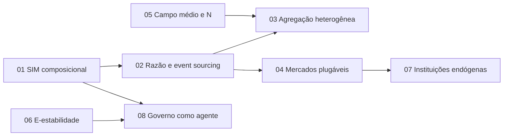

# Toy experiments

Experimentos pequenos, cada um cabe num projeto pessoal e responde a uma pergunta-ponte do [programa de pesquisa](../docs/01-programa-de-pesquisa.md). Cada documento segue o mesmo formato: pergunta, por que importa, modelo, protocolo, critério de sucesso, armadilhas e referências.

| # | Experimento | Pergunta | Fase do programa | Depende de |
| --- | --- | --- | --- | --- |
| 01 | [SIM composicional](01-sim-composicional.md) | A composição em AlgebraicJulia reproduz exatamente o SIM escrito à mão? | 1 | — |
| 02 | [Razão de partida dobrada e event sourcing](02-razao-partida-dobrada.md) | Dá para tornar a consistência stock-flow estrutural em vez de testada? | 1 | 01 |
| 03 | [Famílias heterogêneas e agregação](03-agregacao-heterogenea.md) | Quando a soma de famílias heterogêneas se comporta como a família agregada? | 1 → 3 | 01, 02 |
| 04 | [Mercados plugáveis e inteligência zero](04-mercados-plugaveis-zi.md) | Quanto da eficiência de um mercado vem da regra, e quanto dos agentes? | 4 | 02 |
| 05 | [Campo médio e escala de N](05-campo-medio-escala-n.md) | Como o erro entre ABM e limite de campo médio cai com N? Quando quebra? | 3 | — |
| 06 | [E-estabilidade na teia de aranha](06-e-estabilidade-cobweb.md) | Agentes que aprendem convergem para expectativas racionais? E com ganho constante? | 2 → 3 | — |
| 07 | [Instituições endógenas](07-instituicoes-endogenas.md) | Firmas que escolhem e aprendem regras de venda selecionam as boas regras? | 4 | 04 |
| 08 | [Governo como agente](08-governo-como-agente.md) | Regra fixa, discrição, aprendizado ou composição de subagentes: quando a diferença importa? | 5 | 01, 06 |

## Ordem sugerida

Duas trilhas independentes podem andar em paralelo:

- **Trilha de engenharia (01 → 02 → 03/04 → 07):** construir a arquitetura e estudar economia (Godley e Lavoie, mercados, evolucionária).
- **Trilha matemática (05, 06):** pequenos ABMs com limite conhecido, para gerar conjecturas e tentar provar (propagação de caos, aproximação estocástica).

Os experimentos 05 e 06 não precisam de AlgebraicJulia; podem ser feitos em Julia puro (ou Python) desde já.

## Convenções

- Cada experimento vira uma pasta `experiments/NN-nome/` quando começar a ter código: `README.md` (este documento evolui para relatório), `src/`, `notebooks/`, `results/`.
- Toda simulação estocástica recebe semente explícita e é rodada em várias sementes.
- Resultados numéricos que entram em texto são gerados por script, não copiados à mão.
